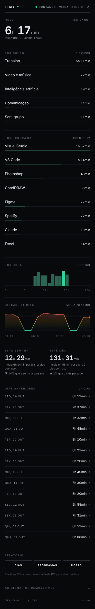
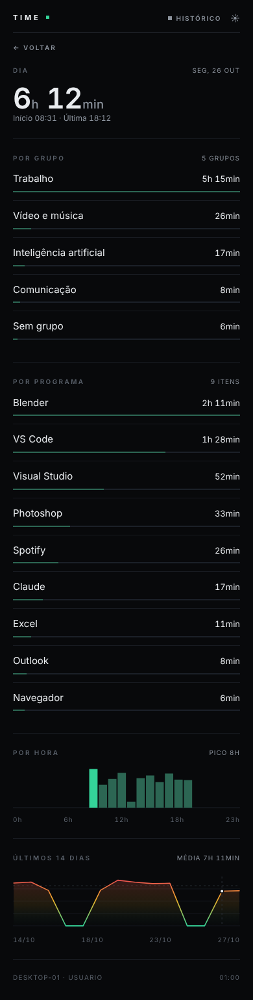
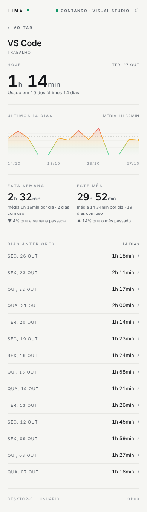

# Time

[English](README.md) · **Português** · [中文](README.zh-CN.md)

Feito por **Daniel 'dnyaary' Carvalho** · [instagram.com/dnyaary](https://instagram.com/dnyaary)

**Mede o seu próprio tempo de uso do PC e mostra tudo num painel no celular, pela rede local.** Sem conta, sem nuvem, sem instalador.

O Time roda escondido no Windows e conta o tempo em que o computador está realmente em uso — não só ligado. Ele olha o que está em primeiro plano e pausa sozinho quando você sai. O que mediu vira um painel web servido pelo próprio PC, aberto no celular pelo IP da rede local. Vários computadores podem aparecer somados no mesmo link.

> A interface segue o idioma do Windows (na janela) e do celular (no painel): português quando o sistema está em português, inglês nos demais.

<p>
  
  
  
</p>

## O que ele faz

- **Tempo de uso real:** conta enquanto o PC está em uso e pausa depois de um tempo sem atividade. Cada programa entra na conta de quem está em primeiro plano.
- **Por programa:** lista os programas de hoje, com uma barra do tamanho de cada um. Os nomes são agrupados por regras simples (`categorias.txt`), então "X (Twitter)", "YouTube" etc. aparecem como você escolher.
- **Por hora:** gráfico de barras com as horas do dia em que você mais usa o PC.
- **Últimos 14 dias:** gráfico de linha com a média do período. A linha é verde na base e vai ficando âmbar e vermelha conforme sobe.
- **Semana e mês:** tempo total, média por dia de uso e comparação com a semana e o mês anteriores.
- **Grupos:** separe os programas em grupos (Trabalho, Redes sociais, Vídeo e música…) no `categorias.txt` e veja o tempo de cada grupo.
- **Detalhe de um programa:** toque num programa para ver o histórico dele — hoje, 14 dias, semana e mês.
- **Tema claro e escuro:** segue o celular, com um botão para trocar.
- **Dias anteriores:** abaixo do gráfico, só o resumo de cada dia (data e tempo). Tocando em um dia, abre o gráfico com aquele dia marcado e **todos** os programas usados nele.
- **Relatório:** baixe o histórico (dias, programas ou horas) em planilhas CSV direto do painel.
- **Vários PCs:** cada PC roda o próprio Time; um deles vira o principal e soma os outros. A lista mostra o total e o tempo por computador — tocar em um PC abre só o que ele está usando.
- **Descoberta automática:** os Time ligados na mesma rede se acham sozinhos (UDP 8788). É só digitar o código do outro PC uma vez.
- **Janela discreta:** o atalho abre só uma janelinha com o nome "Time" e um botão de minimizar (minimizar esconde de novo). As informações completas ficam num segundo atalho. O próprio Time também entra na lista de programas, então dá para ver no painel quando você está nele.
- **Nada de nuvem:** os dados ficam em `C:\Program Files\Time`, no seu PC. O painel só responde na rede local e exige um código de acesso.

## Instalação (Windows 10/11, 64 bits)

1. Baixe o `Time.exe` na página de [Releases](../../releases/latest) (arquivo único, autocontido — não precisa instalar .NET).
2. Rode de onde baixou. **Nada aparece na tela** — ele fica escondido.
3. Na primeira execução ele **se instala em `C:\Program Files\Time\Time.exe`** e
   reinicia de lá. Pode apagar o arquivo baixado e a pasta de download: o programa
   não depende mais dela.
4. O Windows pede **duas elevações (UAC)**: uma para criar a pasta e outra para
   liberar o firewall. Aceite as duas.
5. Aperte **Ctrl+Shift+Alt+X e depois 5** para abrir a janela: ela mostra só o nome
   **Time** e o botão de minimizar. Minimizar esconde de novo.
6. Com ela aberta, aperte **Ctrl+Shift+Alt+F2 e depois 1** para ver as informações:
   link do painel, código de acesso e a opção **Iniciar com o Windows**.
7. No celular, abra `http://SEU-IP:8787/?k=SEU-CODIGO` na mesma rede.

Para abrir pelo Explorer, o programa fica em `C:\Program Files\Time\Time.exe`
(botão direito → **Enviar para → Área de trabalho (criar atalho)**).
Para atualizar: feche o Time pelo **X da janela completa**, rode o `.exe` novo e
ele se instala por cima.

Como o `.exe` não tem assinatura digital, o Windows pode avisar "O Windows protegeu o computador" na primeira vez: **Mais informações → Executar assim mesmo**. Se o celular não abrir, quase sempre é uma regra de **bloqueio** de firewall criada ao cancelar aquele aviso do Windows — veja o [manual](docs/manual.md).

## Compilar

Precisa do [.NET 10 SDK](https://dotnet.microsoft.com/download) no Windows.

```powershell
dotnet build
# gera bin\Debug\net10.0-windows\Time.exe (precisa do .NET instalado;
# roda direto da pasta, sem se instalar em Program Files)

dotnet publish -c Release -r win-x64 --self-contained true -p:PublishSingleFile=true
# gera bin\Release\net10.0-windows\win-x64\publish\Time.exe (arquivo único, ~117 MB)
```

A cada push na `main`, o GitHub Actions também compila e deixa o `Time.exe` para baixar na aba **Actions**.

## Estrutura

| Arquivo | Responsabilidade |
|---|---|
| `Program.cs` | contagem, janela, atalho global, firewall, dados, painel e PCs remotos |
| `Api.cs` | servidor HTTP e toda a página do painel (HTML/CSS/JS embutidos) |
| `Descoberta.cs` | descoberta dos outros PCs na rede (UDP 8788, HMAC) |
| `Time.csproj` | projeto .NET 10 WinForms, ícone e metadados |
| `icone.ico` | ícone genérico do Windows embutido no `.exe` |
| `docs/manual.md` | manual do usuário (também em [inglês](docs/manual.en.md) e [chinês](docs/manual.zh-CN.md)) |
| `CHANGELOG.md` | notas de cada versão |

## Onde ficam os dados

Tudo em `C:\Program Files\Time`:

| Arquivo | Conteúdo |
|---|---|
| `atividade_diaria.csv` | total por dia (início, última atividade, segundos) |
| `apps_diario.csv` | tempo por programa, por dia |
| `horas_diario.csv` | tempo em cada hora do dia, por dia |
| `categorias.txt` | regras que agrupam programas |
| `config.txt` | porta, código de acesso e estado do firewall |
| `pcs.txt` | outros PCs do painel |

Copiar essa pasta é o backup completo. Os arquivos são texto simples (CSV), legíveis por qualquer coisa.

## Privacidade

- O programa não envia nada para fora: o painel só responde na rede local.
- O painel exige o código de acesso; sem ele, a API responde `401`.
- A descoberta entre PCs não manda o código, nem em forma de hash: o aviso leva só o nome da máquina e a porta, e o outro PC é confirmado com um desafio HMAC.
- O painel é HTTP simples: dentro da rede, o código vai no endereço (`?k=`) sem criptografia. Use em redes que você confia e não exponha a porta na internet.
- O que é medido: nome do processo em primeiro plano e tempo. O título da janela só é comparado com as regras na hora e **nunca é salvo**. O conteúdo das janelas não é lido.
- Se usar em PCs de outras pessoas (funcionários, por exemplo), avise por escrito o que é medido — o manual explica.

## Limitações

- Só Windows (WinForms + APIs do Windows).
- O painel precisa do PC ligado, do Time rodando e do celular na mesma rede.
- Não funciona por VPN/dados móveis por padrão; para acessar de fora seria preciso abrir a porta no roteador (não recomendado).
- Sem instalador e sem assinatura digital.

## Licença

[MIT](LICENSE) © 2026 Daniel 'dnyaary' Carvalho — [instagram.com/dnyaary](https://instagram.com/dnyaary)

Pode usar, copiar, modificar e distribuir, inclusive comercialmente, desde que mantenha o aviso de copyright e a licença.

---

*Time · by Daniel 'dnyaary' Carvalho*
