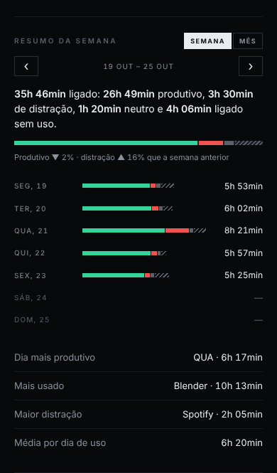

# Time

[English](README.md) · **Português** · [中文](README.zh-CN.md)

Feito por **Daniel 'dnyaary' Carvalho** · [instagram.com/dnyaary](https://instagram.com/dnyaary)

**Mede o seu próprio tempo de uso do PC e mostra tudo num painel no celular, pela rede local.** Sem conta, sem nuvem, sem instalador.

O Time roda escondido no Windows e conta o tempo em que o computador está realmente em uso — não só ligado. Ele olha o que está em primeiro plano e pausa sozinho quando você sai. O que mediu vira um painel web servido pelo próprio PC, aberto no celular pelo IP da rede local. Vários computadores podem aparecer somados no mesmo link.

> A interface segue o idioma do Windows (na janela) e do celular (no painel): português quando o sistema está em português, inglês nos demais.

<p>
  
  
  
  
</p>

## Por que o Time?

Existem muitos programas de tempo de tela. O Time é para quem quer ver para onde vai o tempo **sem entregar esses dados para ninguém**:

- **Nada sai da sua rede.** Sem conta, sem nuvem de terceiros, sem telemetria. Os dados são arquivos CSV simples no seu próprio PC — e, só se você quiser, num servidor seu.
- **O celular é o painel.** Abra um link na mesma rede Wi-Fi e veja o seu dia, sem instalar nada no celular.
- **Vários PCs, um link só.** O PC de casa, o notebook e os PCs do escritório se acham na rede e aparecem somados num painel só.
- **Não atrapalha.** Sem ícone na bandeja e sem janelas pulando na tela: roda escondido e só aparece quando você aperta o atalho.
- **Privado de verdade.** O título das janelas nunca é salvo, e é você quem decide como os programas são agrupados.
- **Um arquivo só.** Um único `.exe` que se instala sozinho; código aberto, sob a licença MIT.

## O que ele faz

- **Tempo de uso real:** conta enquanto o PC está em uso e pausa depois de um tempo sem atividade. Cada programa entra na conta de quem está em primeiro plano.
- **Por programa:** lista os programas de hoje, com uma barra do tamanho de cada um. Os nomes são agrupados por regras simples (`categorias.txt`), então "X (Twitter)", "YouTube" etc. aparecem como você escolher.
- **Por hora:** gráfico de barras com as horas do dia em que você mais usa o PC.
- **Últimos 14 dias:** gráfico de linha com a média do período. A linha é verde na base e vai ficando âmbar e vermelha conforme sobe.
- **Semana e mês:** tempo total, média por dia de uso e comparação com a semana e o mês anteriores.
- **Grupos:** separe os programas em grupos (Trabalho, Redes sociais, Vídeo e música…) no `categorias.txt` e veja o tempo de cada grupo.
- **Foco:** marque grupos como produtivo ou distração (`[Trabalho | produtivo]`) e veja, no painel e na janela, quanto do dia foi para cada um.
- **Resumo do dia já mastigado:** "10h ligado: 3h produtivo, 3h de distração, 2h neutro e 2h ligado sem uso", com uma barra e a porcentagem de cada parte.
- **Resumo da semana e do mês:** qualquer semana ou mês do histórico, com setas para voltar — a mesma frase para o período inteiro, uma barra por dia (ou por semana), a comparação com a semana anterior, o dia mais produtivo, o programa mais usado e a maior distração.
- **Pausar:** um botão na janela para a contagem por 15 minutos, 1 hora ou até retomar — para um intervalo, ou quando outra pessoa vai usar o PC.
- **Tempo parado:** conta também quanto tempo o PC ficou ligado sem ninguém usando ("Ligado sem uso"), separado do tempo de uso real.
- **Servidor próprio (opcional):** veja o painel de qualquer lugar, com o histórico de todos os PCs mesmo desligados — veja [Servidor](#servidor-opcional).
- **Firme com a rede instável:** se um PC para de responder, o painel mantém os últimos dados dele e marca como offline, então o total não cai e volta. PC em duas redes mostra um link para cada.
- **Detalhe de um programa:** toque num programa para ver o histórico dele — hoje, 14 dias, semana e mês.
- **Tema claro e escuro:** segue o celular, com um botão para trocar.
- **Dias anteriores:** abaixo do gráfico, só o resumo de cada dia (data e tempo). Tocando em um dia, abre o gráfico com aquele dia marcado e **todos** os programas usados nele.
- **Relatório:** baixe o resumo da semana ou do mês (dia a dia e por programa, com produtivo, distração e tempo parado) ou o histórico completo (dias, programas ou horas) em planilhas CSV direto do painel.
- **Vários PCs:** cada PC roda o próprio Time; um deles vira o principal e soma os outros. A lista mostra o total e o tempo por computador — tocar em um PC abre só o que ele está usando.
- **Descoberta automática:** os Time ligados na mesma rede se acham sozinhos (UDP 8788). É só digitar o código do outro PC uma vez.
- **Janela discreta:** o atalho abre só uma janelinha com o nome "Time" e um botão de minimizar (minimizar esconde de novo). As informações completas ficam num segundo atalho. O próprio Time também entra na lista de programas, então dá para ver no painel quando você está nele.
- **Nada de nuvem:** os dados ficam em `C:\Program Files\Time`, no seu PC. O painel só responde na rede local e exige um código de acesso.

## Instalação (Windows 10/11, 64 bits)

> **O navegador pode avisar sobre o download.** Edge e Chrome mostram "O Time.exe não é baixado com frequência" para programas novos sem assinatura digital. No Edge: **⋯ → Manter → Mostrar mais → Manter assim mesmo**. No Chrome: **Manter**. Para conferir que o arquivo é o publicado aqui, compare com o `Time.exe.sha256` da mesma release (`certutil -hashfile Time.exe SHA256`), ou compile você mesmo a partir do código.

1. Baixe o `Time.exe` na página de [Releases](../../releases/latest) (arquivo único, autocontido — não precisa instalar .NET).
2. Rode de onde baixou. **Nada aparece na tela** — ele fica escondido.
3. Na primeira execução ele **se instala em `C:\Program Files\Time\Time.exe`** e
   reinicia de lá. Pode apagar o arquivo baixado e a pasta de download: o programa
   não depende mais dela.
4. O Windows pede **duas elevações (UAC)**: uma para criar a pasta e outra para
   liberar o firewall. Aceite as duas.
5. Aperte **Ctrl+Shift+Alt+X e depois 5** para abrir a janela: ela mostra só o nome
   **Time** e o botão de minimizar. Minimizar esconde de novo.
6. Com ela aberta, aperte **Ctrl+Shift+Alt+F2 e depois 1** para ver as informações:
   link do painel, código de acesso e a opção **Iniciar com o Windows**.
7. No celular, abra `http://SEU-IP:8787/?k=SEU-CODIGO` na mesma rede.

Para abrir pelo Explorer, o programa fica em `C:\Program Files\Time\Time.exe`
(botão direito → **Enviar para → Área de trabalho (criar atalho)**).
Para atualizar: feche o Time pelo **X da janela completa**, rode o `.exe` novo e
ele se instala por cima.

Como o `.exe` não tem assinatura digital, o Windows pode avisar "O Windows protegeu o computador" na primeira vez: **Mais informações → Executar assim mesmo**. Se o celular não abrir, quase sempre é uma regra de **bloqueio** de firewall criada ao cancelar aquele aviso do Windows — veja o [manual](docs/manual.md).

## Servidor (opcional)

Por padrão nada sai da sua rede. Se quiser abrir o painel **de qualquer lugar** (dados móveis, outro Wi-Fi) e continuar vendo o histórico de um PC mesmo com ele desligado, dá para subir um servidorzinho **seu** na Cloudflare — grátis nesse volume, na sua própria conta. Cada PC manda o resumo do dia a cada minuto; se a internet cair, ele continua contando e manda tudo quando ela voltar.

**Guia completo, com manutenção e problemas comuns: [docs/servidor.md](docs/servidor.md).** Em resumo — precisa do [Node.js](https://nodejs.org) (LTS) e de uma conta grátis na Cloudflare. Na pasta `servidor`:

```powershell
copy wrangler.exemplo.toml wrangler.toml
npm install
npx wrangler login                    # abre o navegador para autorizar a sua conta
npx wrangler d1 create time           # copie o database_id que aparecer para o wrangler.toml
npm run banco                         # cria as tabelas
npx wrangler secret put CHAVE_ENVIO   # a chave de envio que os PCs vão usar (capriche no tamanho)
npx wrangler secret put CODIGO        # o código para abrir o painel
npm run deploy
```

Ele publica em `https://time.<sua-conta>.workers.dev`. Com um domínio na Cloudflare dá para usar um endereço seu: tire o `#` da linha `routes` no `wrangler.toml` (ex.: `time.seudominio.com`) e rode `npm run deploy` de novo. Ajuste o `FUSO` no `wrangler.toml` para o seu fuso horário.

Depois, na janela do Time de cada PC: **Configurar** → endereço do servidor e chave de envio → OK. A caixa **Enviar para o servidor** fica marcada e a linha de baixo mostra o último envio. No celular, abra o endereço e digite o `CODIGO`.

## Compilar

Precisa do [.NET 10 SDK](https://dotnet.microsoft.com/download) no Windows.

```powershell
dotnet build
# gera bin\Debug\net10.0-windows\Time.exe (precisa do .NET instalado;
# roda direto da pasta, sem se instalar em Program Files)

dotnet publish -c Release -r win-x64 --self-contained true -p:PublishSingleFile=true
# gera bin\Release\net10.0-windows\win-x64\publish\Time.exe (arquivo único, ~117 MB)
```

A cada push na `main`, o GitHub Actions também compila e deixa o `Time.exe` para baixar na aba **Actions**.

## Estrutura

| Arquivo | Responsabilidade |
|---|---|
| `Program.cs` | ponto de entrada: instância única e instalação em Program Files |
| `Contador.cs` | contagem do tempo, janelas e iniciar com o Windows |
| `Contador.*.cs` | as outras partes do contador: link do painel e firewall (`Painel`), envio para o servidor (`Servidor`), PCs remotos (`Remotos`), dados do painel e CSV (`Api`), regras e foco (`Regras`), pausa (`Pausa`), arquivos de dados (`Dados`) |
| `Janelas.cs` | a janela completa, a janela mínima e a janela de configurar o servidor |
| `servidor/` | o servidor opcional (Cloudflare Worker + D1): recebimento, banco e o mesmo painel |
| `docs/servidor.md` | guia do servidor (também em [inglês](docs/servidor.en.md) e [chinês](docs/servidor.zh-CN.md)) |
| `Modelos.cs`, `AtalhoGlobal.cs`, `Idioma.cs` | tipos de dados, atalho global, textos em português/inglês |
| `Api.cs` | servidor HTTP e toda a página do painel (HTML/CSS/JS embutidos) |
| `Descoberta.cs` | descoberta dos outros PCs na rede (UDP 8788, HMAC) |
| `Time.csproj` | projeto .NET 10 WinForms, ícone e metadados |
| `icone.ico` | ícone genérico do Windows embutido no `.exe` |
| `docs/manual.md` | manual do usuário (também em [inglês](docs/manual.en.md) e [chinês](docs/manual.zh-CN.md)) |
| `CHANGELOG.md` | notas de cada versão |

## Onde ficam os dados

Tudo em `C:\Program Files\Time`:

| Arquivo | Conteúdo |
|---|---|
| `atividade_diaria.csv` | total por dia (início, última atividade, segundos) |
| `apps_diario.csv` | tempo por programa, por dia |
| `horas_diario.csv` | tempo em cada hora do dia, por dia |
| `categorias.txt` | regras que agrupam programas |
| `config.txt` | porta, código de acesso e estado do firewall |
| `pcs.txt` | outros PCs do painel |
| `pcs_dados.json` | últimos dados recebidos de cada um desses PCs (usados enquanto um está offline) |

Copiar essa pasta é o backup completo. Os arquivos são texto simples (CSV), legíveis por qualquer coisa.

### Regras (`categorias.txt`)

Uma regra por linha, no formato `tipo: texto = Nome | tolerância`:

```text
site: YouTube = YouTube | 600        # só no título da aba do navegador; conta até 10 min parado
programa: CorelDRW = CorelDRAW       # começo do nome do processo (sem .exe)
titulo: Nota fiscal = Notas          # título de qualquer janela
```

Uma linha `[Grupo]` agrupa as regras de baixo, e a marca opcional diz se o grupo é produtivo ou distração nos resumos:

```text
[Trabalho | produtivo]
programa: devenv = Visual Studio

[Redes sociais | distração]
site: Instagram = Instagram
```

A primeira regra que bater vence; o que não bater em nenhuma conta como **"Outros"**. O arquivo recarrega sozinho alguns segundos depois de salvo.

## Privacidade

- O programa não envia nada para fora: o painel só responde na rede local. A única exceção é o servidor opcional, que você mesmo cria na sua conta — os PCs mandam para ele os resumos dos dias (nomes dos programas e tempos, nunca títulos de janela) por HTTPS, com a chave de envio.
- O painel exige o código de acesso; sem ele, a API responde `401`.
- A descoberta entre PCs não manda o código, nem em forma de hash: o aviso leva só o nome da máquina e a porta, e o outro PC é confirmado com um desafio HMAC.
- O painel é HTTP simples: dentro da rede, o código vai no endereço (`?k=`) sem criptografia. Use em redes que você confia e não exponha a porta na internet.
- O que é medido: nome do processo em primeiro plano e tempo. O título da janela só é comparado com as regras na hora e **nunca é salvo**. O conteúdo das janelas não é lido.
- Se usar em PCs de outras pessoas (funcionários, por exemplo), avise por escrito o que é medido — o manual explica.

## Limitações

- Só Windows (WinForms + APIs do Windows).
- O painel precisa do PC ligado, do Time rodando e do celular na mesma rede.
- Fora da rede ele só abre pelo servidor opcional. Nunca abra a porta no roteador.
- Sem instalador e sem assinatura digital.

## Licença

[MIT](LICENSE) © 2026 Daniel 'dnyaary' Carvalho — [instagram.com/dnyaary](https://instagram.com/dnyaary)

Pode usar, copiar, modificar e distribuir, inclusive comercialmente, desde que mantenha o aviso de copyright e a licença.

---

*Time · by Daniel 'dnyaary' Carvalho*
