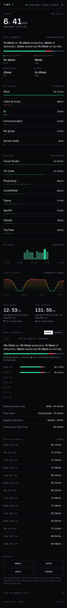
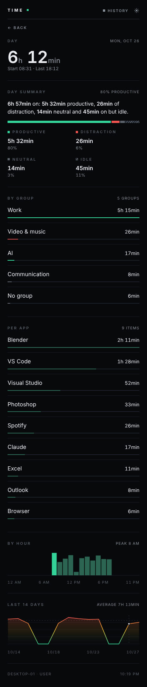
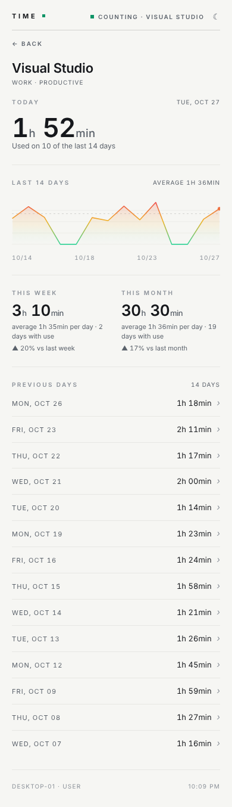

# Time

[English](README.md) · [Português](README.pt-BR.md) · **中文**

> 本文档译自英文版，可能存在不准确之处。如发现错误，欢迎提交 Issue 或 Pull Request 指正。

作者：**Daniel 'dnyaary' Carvalho** · [instagram.com/dnyaary](https://instagram.com/dnyaary)

**统计你真正使用电脑的时间，并通过局域网在手机上的仪表盘中显示。** 无需账号，无需云端，无需安装程序。

Time 在 Windows 后台隐藏运行，只统计电脑真正被使用的时间，而不仅仅是开机时间。它会检测当前处于前台的程序，你离开时会自动暂停。统计结果会变成一个由电脑本身提供的网页仪表盘，在手机上通过局域网 IP 打开。多台电脑可以在同一个链接中合计显示。

> 界面语言跟随 Windows（窗口）和手机（仪表盘）的语言：系统为葡萄牙语时显示葡萄牙语，其他语言（包括中文）显示英语。

<p>
  
  
  
</p>

## 为什么选择 Time？

屏幕时间统计软件有很多。Time 适合那些想知道时间花在哪里、**又不想把这些数据交给任何人**的用户：

- **数据不出局域网。** 无需账号，不使用云端，没有遥测。数据只是保存在你自己电脑上的普通 CSV 文件。
- **手机就是仪表盘。** 在同一 Wi-Fi 下打开一个链接即可查看你的一天，手机上无需安装任何东西。
- **多台电脑，一个链接。** 家里的电脑、笔记本和办公室的电脑会在网络中自动互相发现，并汇总到同一个仪表盘中。
- **不打扰你。** 没有托盘图标，也不会弹出窗口：它在后台隐藏运行，只有按下快捷键时才会出现。
- **从设计上保护隐私。** 从不保存窗口标题，程序如何分组也由你决定。
- **只有一个文件。** 单个 `.exe`，会自动安装；以 MIT 许可证开源。

## 功能

- **真实使用时间：** 电脑在使用时计时，一段时间没有鼠标或键盘操作后自动暂停。每一段时间都记在当时位于前台的程序上。
- **按程序统计：** 列出今天使用的程序，每个程序都有一条与时长成比例的进度条。程序名称按简单规则（`categorias.txt`）归类，因此 "X (Twitter)"、"YouTube" 等名称都可以按你的需要显示。
- **按小时：** 柱状图，显示一天中你最常使用电脑的时段。
- **最近 14 天：** 折线图并显示这段时间的平均值。线条在底部为绿色，越高越变为琥珀色和红色。
- **本周和本月：** 总时长、有使用的日子的日均时长，以及与上周、上月的比较。
- **分组：** 在 `categorias.txt` 中把程序分组（工作、社交媒体、视频和音乐……），查看每个分组的时长。
- **专注：** 把分组标记为高效或分心（`[Work | productive]`），在仪表盘和窗口中查看一天中各占多少时间。
- **一目了然的每日摘要：** "开机 10 小时：3 小时高效、3 小时分心、2 小时中性、2 小时开机但空闲"，并配有进度条和各部分的百分比。
- **每周和每月摘要：** 历史中的任何一周或一个月，可用箭头向前翻——整个时间段的同样摘要、每天（或每周）一条进度条、与前一周的比较、最高效的一天、最常用的程序以及最大的分心来源。
- **暂停：** 窗口中的按钮可以暂停计时 15 分钟、1 小时或直到你恢复——适合休息，或别人临时使用电脑时。
- **空闲时间：** 另外统计电脑开着但无人使用的时间（"On but idle"），与真实使用时间分开。
- **网络不稳定时依然可靠：** 如果某台电脑暂时没有响应，仪表盘会保留它最后发送的数据并标记为离线，总时长不会忽高忽低。连接两个网络的电脑会为每个网络各显示一个链接。
- **程序详情：** 点击某个程序即可查看它的历史——今天、最近 14 天、本周和本月。
- **浅色和深色主题：** 跟随手机设置，也可以用按钮切换。
- **往日记录：** 图表下方显示每一天的摘要（日期和时长）。点击某一天，会打开标出该日的图表，并列出当天使用的**所有**程序。
- **报告：** 直接在仪表盘中下载每周或每月摘要（按天和按程序，包含高效、分心和空闲时间）或完整历史记录（按天、按程序或按小时）的 CSV 表格。
- **多台电脑：** 每台电脑各自运行 Time；其中一台作为主机，汇总其他电脑的数据。列表显示总时长和每台电脑的时长，点击某台电脑即可只查看它正在使用的内容。
- **自动发现：** 同一网络中运行的 Time 会自动互相发现（UDP 8788）。只需输入一次另一台电脑的访问码。
- **低调的窗口：** 快捷键只打开一个显示 "Time" 名称和最小化按钮的小窗口（最小化即重新隐藏）。完整信息需要用第二个快捷键打开。Time 本身也会出现在程序列表中，因此仪表盘上能看到你打开它的时间。
- **不使用云端：** 数据保存在你电脑上的 `C:\Program Files\Time`。仪表盘只在局域网内响应，并且需要访问码。

## 安装（Windows 10/11，64 位）

> **浏览器可能会对下载发出警告。** 对于没有数字签名的新程序，Edge 和 Chrome 会提示"Time.exe 通常不会被下载"。在 Edge 中：**⋯ → 保留 → 显示更多 → 仍然保留**。在 Chrome 中：**保留**。如需确认文件就是这里发布的版本，可与同一 Release 中的 `Time.exe.sha256` 比对（`certutil -hashfile Time.exe SHA256`），或者自行从源代码编译。

1. 从 [Releases](../../releases/latest) 页面下载 `Time.exe`（单个独立文件，无需安装 .NET）。
2. 在下载位置直接运行。**屏幕上不会出现任何东西**，程序在后台隐藏运行。
3. 首次运行时，它会**把自己安装到 `C:\Program Files\Time\Time.exe`**，
   并从那里重新启动。之后可以删除下载的文件和下载文件夹，程序不再依赖它们。
4. Windows 会请求**两次管理员权限（UAC）**：一次用于创建文件夹，一次用于
   开放防火墙。请都点击允许。
5. 按 **Ctrl+Shift+Alt+X，然后按 5** 打开窗口：只显示名称 **Time** 和最小化按钮。
   最小化即重新隐藏。
6. 窗口打开时，按 **Ctrl+Shift+Alt+F2，然后按 1** 查看详细信息：仪表盘链接、
   访问码，以及 **"Start with Windows"**（开机自动启动）选项。
7. 在同一网络的手机上打开 `http://你的IP:8787/?k=你的访问码`。

如需从资源管理器打开，程序位于 `C:\Program Files\Time\Time.exe`
（右键 → **发送到 → 桌面快捷方式**）。
更新方法：通过**完整窗口的 X** 关闭 Time，运行新的 `.exe`，它会覆盖安装。

由于 `.exe` 没有数字签名，首次运行时 Windows 可能会提示"Windows 已保护你的电脑"：点击 **更多信息 → 仍要运行**。如果手机无法打开仪表盘，几乎都是因为取消了那个 Windows 防火墙提示，系统自动创建了一条**阻止**规则，详见[使用手册](docs/manual.zh-CN.md)。

## 编译

需要在 Windows 上安装 [.NET 10 SDK](https://dotnet.microsoft.com/download)。

```powershell
dotnet build
# 生成 bin\Debug\net10.0-windows\Time.exe（需要已安装 .NET；
# 直接从该文件夹运行，不会安装到 Program Files）

dotnet publish -c Release -r win-x64 --self-contained true -p:PublishSingleFile=true
# 生成 bin\Release\net10.0-windows\win-x64\publish\Time.exe（单个文件，约 117 MB）
```

每次推送到 `main` 分支时，GitHub Actions 也会自动编译，并在 **Actions** 标签页提供 `Time.exe` 下载。

## 项目结构

| 文件 | 用途 |
|---|---|
| `Program.cs` | 程序入口：单实例运行，并自动安装到 Program Files |
| `Contador.cs` | 计时、窗口和开机自动启动 |
| `Contador.*.cs` | 计时器的其他部分：仪表盘链接和防火墙（`Painel`）、远程电脑（`Remotos`）、仪表盘数据和 CSV（`Api`）、规则和专注（`Regras`）、暂停（`Pausa`）、数据文件（`Dados`） |
| `Janelas.cs` | 完整窗口和小窗口 |
| `Modelos.cs`、`AtalhoGlobal.cs`、`Idioma.cs` | 数据类型、全局快捷键、葡萄牙语/英语文本 |
| `Api.cs` | HTTP 服务器和完整的仪表盘页面（内嵌 HTML/CSS/JS） |
| `Descoberta.cs` | 在网络中发现其他电脑（UDP 8788，HMAC） |
| `Time.csproj` | .NET 10 WinForms 项目、图标和元数据 |
| `icone.ico` | 内嵌在 `.exe` 中的 Windows 通用图标 |
| `docs/manual.zh-CN.md` | 使用手册（另有[英文版](docs/manual.en.md)和[葡萄牙语版](docs/manual.md)） |
| `CHANGELOG.md` | 版本说明（葡萄牙语） |

源代码（命名和注释）使用葡萄牙语编写。

## 数据存放位置

全部位于 `C:\Program Files\Time`：

| 文件 | 内容 |
|---|---|
| `atividade_diaria.csv` | 每日合计（开始时间、最后活动时间、秒数） |
| `apps_diario.csv` | 每天每个程序的使用时间 |
| `horas_diario.csv` | 每天每个小时的使用时间 |
| `categorias.txt` | 程序归类规则 |
| `config.txt` | 端口、访问码和防火墙状态 |
| `pcs.txt` | 仪表盘中的其他电脑 |
| `pcs_dados.json` | 从这些电脑收到的最新数据（某台电脑离线时使用） |

复制这个文件夹就是完整备份。这些文件都是纯文本（CSV），任何软件都能读取。

### 规则（`categorias.txt`）

每行一条规则，格式为 `类型: 文本 = 名称 | 容忍时间`：

```text
site: YouTube = YouTube | 600        # 仅匹配浏览器标签页标题；静止 10 分钟内仍继续计时
program: CorelDRW = CorelDRAW        # 进程名称的开头（不含 .exe）
title: Invoice = Invoices            # 任意窗口的标题
```

用 `[分组]` 行把下面的规则归为一组，并可以为专注统计标记该分组：

```text
[Work | productive]
program: devenv = Visual Studio

[Social media | distraction]
site: Instagram = Instagram
```

`site` = 网站，`program` = 程序，`title` = 窗口标题，`productive` = 高效，`distraction` = 分心（葡萄牙语关键字 `programa`、`titulo`、`produtivo`、`distração` 同样有效）。第一条匹配的规则生效；不匹配任何规则的内容计入 **"Others"**（其他）。保存文件几秒后会自动重新加载。

## 隐私

- 程序不会向外部发送任何数据：仪表盘只在局域网内响应。
- 仪表盘需要访问码；没有访问码时 API 返回 `401`。
- 电脑之间的自动发现不会发送访问码，哪怕是哈希值也不会：广播只包含电脑名称和端口，并通过 HMAC 质询来验证另一台电脑。
- 仪表盘使用普通 HTTP：在局域网内，访问码以未加密的形式出现在地址中（`?k=`）。请只在你信任的网络中使用，切勿把端口暴露到互联网。
- 统计内容：前台进程名称和时间。窗口标题只在当时与规则比对，**从不保存**。不会读取窗口内容。
- 如果在他人的电脑上使用（例如员工的电脑），请以书面形式告知对方统计了哪些内容。

## 限制

- 仅支持 Windows（WinForms + Windows API）。
- 仪表盘需要电脑开机、Time 正在运行，并且手机在同一网络中。
- 离开局域网后无法打开。切勿在路由器上开放端口。
- 没有安装程序，也没有数字签名。

## 许可证

[MIT](LICENSE) © 2026 Daniel 'dnyaary' Carvalho — [instagram.com/dnyaary](https://instagram.com/dnyaary)

你可以使用、复制、修改和分发本软件（包括商业用途），但必须保留版权声明和许可证。

---

*Time · by Daniel 'dnyaary' Carvalho*
